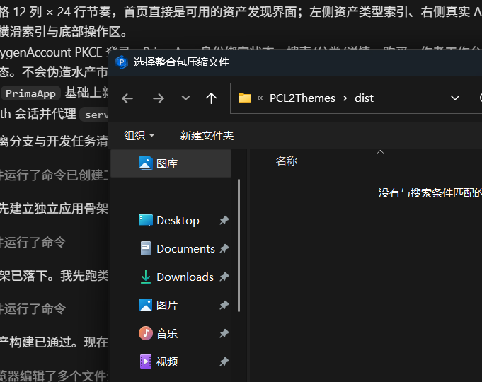

# Issue #1 evidence

The issue is fixed by restoring the two gated `PCL.ModModpack.ModpackInstall` overloads and
delegating every supported archive type to PCL's existing `InstallPack*` implementations.

## File picker

Official PCL 2.99.0.0:



Official PCL 2.99.0.1:


Both runs reached `选择整合包压缩文件`, kept the main PCL window as owner, closed through normal
cancel semantics, and finished self-test with `ok=84 fail=0`.

## Native dispatch

On both hosts, a CurseForge fixture reached:

```text
整合包格式分发恢复已安装：method=PCL.ModModpack.ModpackInstall bits=0xFF25 (FF25=abs-jmp)
[e2e] 整合包安装分发结果：PCL.ModLoader+LoaderCombo<string>
  CurseForge 整合包安装：SwapIssue1E2E
```

This is PCL's own loader combo, after its own taskbar registration and start path, not a
Swap-side mock installer.

## Regression

`--modpacktest` covers:

- CurseForge, Modrinth, HMCL, MMC, MCBBS, launcher-pack and plain-archive dispatch;
- nested archive base-folder preservation;
- `InstanceName` and `Logo` passthrough;
- the zero-argument picker path;
- module-disable fallback to both original gates.
